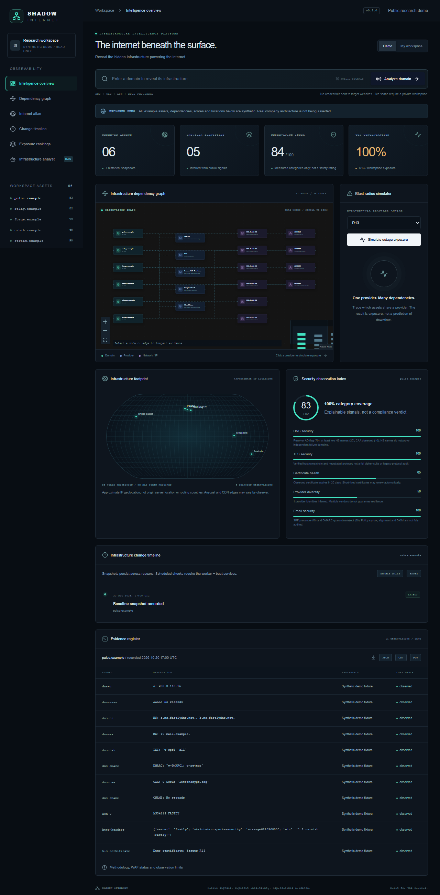
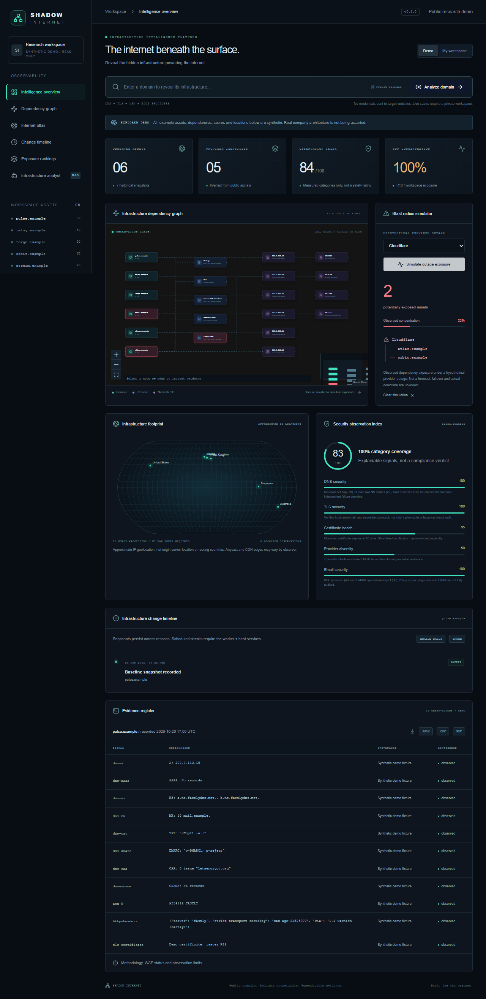
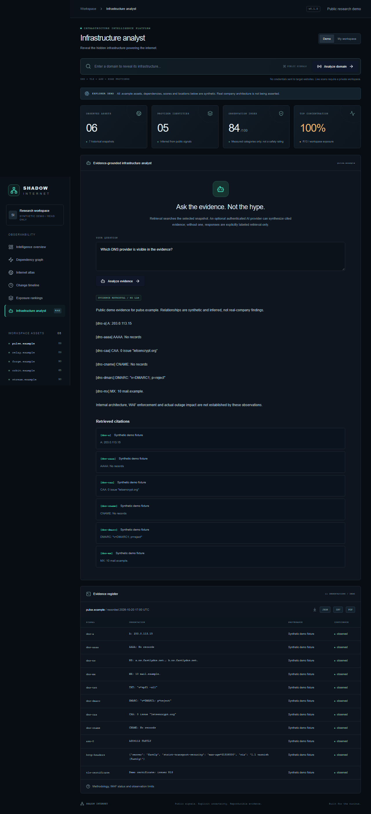
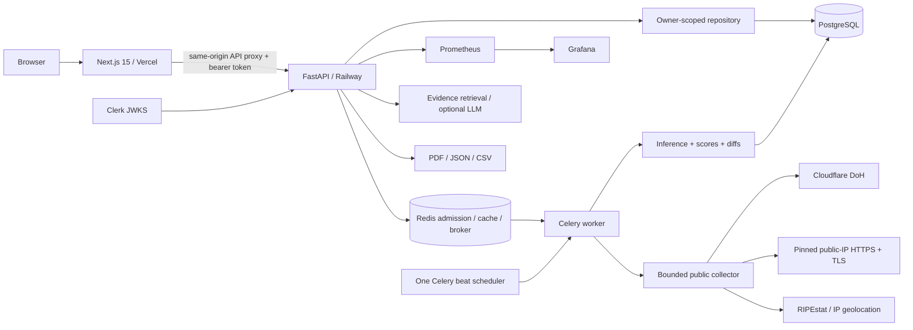

# SHADOW INTERNET

### Reveal the hidden infrastructure powering the internet.

An evidence-first infrastructure intelligence workbench for engineering teams, technical due diligence, and vendor-concentration research. Enter a public domain, collect its observable infrastructure signals, explore the dependency graph, and inspect how shared providers create **potential exposure** across your workspace.

**Not a vulnerability scanner. Not an internal architecture oracle. Not an outage prediction engine.**

The public demo uses explicitly synthetic `.example` assets. Live scans are a separate authenticated workflow. Unknown signals remain unknown; a failed network probe is never presented as proof of insecurity.

## Product tour

| Surface | What works |
|---|---|
| Public-domain recon | A/AAAA/NS/MX/TXT/CAA/CNAME and DMARC via DNS-over-HTTPS; public-address validation; pinned-IP HTTPS HEAD and verified TLS certificate; ASN/ownership from RIPEstat; approximate IP geolocation |
| Infrastructure graph | Draggable React Flow nodes, pan/zoom, animated relationships, minimap, edge provenance, domain/provider/IP/ASN nodes |
| Provider exposure | Latest snapshot per domain; concentration percentages; reverse dependency traversal and affected-asset highlighting |
| Internet atlas | D3 geographic projection without keys; optional interactive Mapbox dark map with public token |
| Observation index | Five explainable categories with individual evidence IDs, unknown values and coverage: DNS, TLS, certificates, provider diversity, email policies |
| Snapshot history | Persistent snapshots, certificate fingerprints, DNS/provider/header diffs; daily monitoring controls |
| Scheduled monitoring | Celery beat enqueues checks at 6/12/24-hour intervals; worker persists success/failure; stale jobs become explicitly failed |
| Infrastructure analyst | Question-based lexical retrieval over snapshot evidence; optional authenticated OpenAI synthesis with citations; retrieval-only mode clearly labeled |
| Reports | Actual downloadable PDF, JSON and spreadsheet-safe CSV, including sources and limitations |
| Workspace rankings | Scores, measured coverage, dependency complexity and provider exposure within the observed portfolio, **not an internet-wide safest-site ranking** |

### Screenshot gallery

Actual screenshots captured from the running application by the desktop/mobile end-to-end suite. All displayed assets are explicitly synthetic.



| Exposure simulation | Evidence analyst |
|---|---|
|  |  |

[Mobile screenshot](docs/images/mobile.png).

## Engineering decisions

- **Evidence over inference.** Every observation has provenance and a timestamp. Provider identity is inferred by bounded hostname/header/ASN rules and keeps the supporting evidence IDs.
- **No DNS-rebinding shortcut.** The collector rejects private, link-local, multicast, documentation, and IPv4-mapped addresses. HTTPS connects to a validated IP while preserving hostname verification and SNI. It does not re-resolve the hostname, follow redirects, fetch bodies, scan arbitrary ports, or crawl links.
- **Tenant isolation.** Clerk's RS256 signature, issuer, expiration, `nbf` and authorized frontend are checked; every private record lookup is owner-scoped. Demo endpoints cannot retrieve private snapshots.
- **Reliable job state.** Idempotency keys are unique per owner. The database atomically claims queued work; duplicate deliveries do not repeat collection. Errors persist as failed jobs. Stale work is recovered by the scheduler.
- **Bounded resource use.** Ten manual scans per user/hour by default; Redis admission is atomic and fails closed. Public evidence is cached for 15 minutes. Monitoring is capped at ten domains per workspace.
- **Honest scores.** Missing TLS is unknown, not automatically a security failure. SPF/DMARC presence is not a full email audit. Multiple NS names do not prove independent failure domains.
- **No unnecessary AI bill.** Public demo never calls a paid AI provider. The optional live analyst sends only the selected public infrastructure evidence, not account credentials or the entire workspace.

## Architecture



```text
backend/app/
  schemas.py        typed domain / evidence contracts
  collector.py      external I/O and public-address guard
  intelligence.py   deterministic scoring, graph, diffs, exposure
  repository.py     owner-scoped persistence queries
  worker.py         collection tasks / cache / scheduler
  auth.py           Clerk token verification
  analyst.py        retrieval and optional provider adapter
  reports.py        report generation
  main.py           HTTP orchestration / telemetry
frontend/
  app/              application shell and global visual system
  components/       dashboard, graph, atlas, shadcn Button
  lib/              typed API contracts and authenticated transport
observability/      Prometheus scrape + provisioned Grafana dashboard
```

The implementation separates domain rules, I/O adapters, repository queries, queue execution, and UI. It deliberately avoids an interface/factory hierarchy for every function. Clean boundaries matter more than architectural ceremony.

## Local quick start (Windows PowerShell)

Requirements: Python 3.12, Node.js 22+, Git. Docker is optional.

```powershell
cd backend
python -m venv .venv
.\.venv\Scripts\python.exe -m pip install -e ".[dev]"
Copy-Item .env.example .env
.\.venv\Scripts\python.exe -m alembic upgrade head
.\.venv\Scripts\python.exe -m uvicorn app.main:app --host 127.0.0.1 --port 8001
```

In another terminal:

```powershell
cd frontend
npm.cmd ci
Copy-Item .env.example .env.local
npm.cmd run dev
```

Open `http://localhost:3000`. The demo requires no Clerk, Mapbox, OpenAI, Redis or payment account. For **local-only** live scans, explicitly set backend `AUTH_MODE=development` and frontend `NEXT_PUBLIC_DEVELOPMENT_AUTH=true`, then restart both processes. Bind the backend to loopback. Development auth is rejected in production.

If Windows blocks SQLAlchemy's optional native extension, its supported pure-Python mode is available through `$env:DISABLE_SQLALCHEMY_CEXT_RUNTIME="1"`. Do not modify application-control policies.

### Full local stack

Create a root `.env` from `.env.example` with separate random local database/Grafana passwords.

```powershell
docker compose up --build
# Optional monitoring dashboards:
docker compose --profile observability up --build
```

Frontend: `localhost:3000`; API/docs: `localhost:8001/docs`; optional Grafana: `localhost:3001`; Prometheus: `localhost:9090`. Database and broker are **not published** to host ports. Compose uses a loopback-oriented development workspace; do not expose this unauthenticated configuration publicly.

See [deployment guide](docs/DEPLOYMENT.md), [API reference](docs/API.md), and [operating limits](docs/OPERATIONS.md).

## Verification

```powershell
cd backend
.\.venv\Scripts\python.exe -m ruff check app tests migrations
.\.venv\Scripts\python.exe -m ruff format --check app tests migrations
.\.venv\Scripts\python.exe -m pytest
cd ..\frontend
npm.cmd test
npm.cmd run build
npm.cmd run lint
npx.cmd playwright install chromium
# With API and frontend running:
npm.cmd run test:e2e
```

CI checks lint, tests, production build, PostgreSQL migrations, real PostgreSQL/Redis service integrations, and desktop/mobile Chromium E2E flows. Local service-integration tests skip unless their explicit integration URLs are set. No test calls a paid AI provider.

Next.js 15 is retained as requested. Its PostCSS dependency is overridden to a patched compatible 8.x release; the lockfile and audit are checked rather than applying a forced framework-major upgrade.

## Scope, ethics and limitations

- Passive public observations only. Do not use this product for harassment, unauthorized probing or circumventing access controls. Respect external provider rate limits.
- There is no port scanner, exploit tester, brute-force enumerator, DNS takeover tester, authenticated target crawler, or confirmed WAF detector.
- CDN/header fingerprints may be absent, misleading, customized or spoofed. A Cloudflare edge signal **does not prove an enabled WAF**.
- IP ownership does not prove origin hosting. Certificate issuer does not prove DNS/hosting ownership.
- IP coordinates are approximate. Anycast, geography and time change results; **routing countries are not measured**.
- Exposure percentages are scoped to observed assets. They do not model vendor failover, private systems, contractual dependency, resilience or outage probability.
- The analyst is lexical RAG, not an embedding/vector database implementation. Generated answers can still be wrong; citations are the source of truth.
- Automated collection currently uses external public services without an SLA. Partial failures are recorded; refreshes can show incomplete data.
- This is a tested portfolio MVP with production-oriented controls, **not an audited enterprise-ready SaaS**. Paid plans, billing, organization roles, retention enforcement, load/chaos tests, incident response, and external review remain release gates.

## Roadmap

- [ ] Verified-domain ownership and explicit scan policy controls.
- [ ] Organization roles, invitations, retention/deletion and encrypted exports.
- [ ] Observation provenance signatures and external-provider quotas.
- [ ] Cloud provider ownership catalogs with versioned confidence rules.
- [ ] Regional probes and separately labeled anycast observations.
- [ ] Snapshot-delta alerts and provider-change webhooks.
- [ ] Rate-limited analyst quotas and optional vector retrieval.
- [ ] Load/chaos tests, accessibility audit, and independent operational review.

Contributions: [CONTRIBUTING.md](CONTRIBUTING.md).
